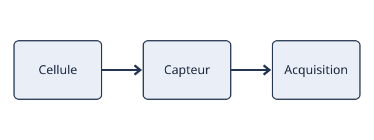

#+TITLE: 11 — Markup for Rich Contents · Repères de correction
#+LANGUAGE: fr
#+OPTIONS: toc:2 num:nil

* Correction — chapitre 11
Énoncés : [[file:../exercices/11-markup-for-rich-contents.org][retour aux exercices]].
Les opérations interactives et horodatées ont plusieurs solutions valides ;
les critères ci-dessous sont des invariants, pas des captures fictives.

** 11.1 — Paragraphs
Commande(s) de référence : =ligne vide ; \\ ; #+BEGIN_VERSE/QUOTE/CENTER=

*** E11-01-A — Résultat attendu
- Critère :: Le saut de paragraphe et la rupture de ligne ne sont pas confondus.
- Contrôle :: Reprendre l’action et vérifier dans le buffer source et,
  si applicable, dans l’agenda ou le document exporté.

*** E11-01-B — Résultat attendu
- Critère :: Chaque bloc conserve la disposition ou l’alignement attendu après export.
- Contrôle :: Reprendre l’action et vérifier dans le buffer source et,
  si applicable, dans l’agenda ou le document exporté.

** 11.2 — Emphasis and Monospace
Commande(s) de référence : =*gras* ; /italique/ ; _souligné_ ; +barré+ ; =verbatim= ; ~code~=

*** E11-02-A — Résultat attendu
- Critère :: Le rendu de chaque délimiteur est distinct à l’export.
- Contrôle :: Reprendre l’action et vérifier dans le buffer source et,
  si applicable, dans l’agenda ou le document exporté.

*** E11-02-B — Résultat attendu
- Critère :: La syntaxe Org contenue dans =...= ou ~...~ n’est pas réinterprétée.
- Contrôle :: Reprendre l’action et vérifier dans le buffer source et,
  si applicable, dans l’agenda ou le document exporté.

** 11.3 — Embedded LaTeX
Commande(s) de référence : =\alpha ; _{...} ; $...$ ; \(...\) ; \[...\] ; equation=

*** E11-03-A — Résultat attendu
- Critère :: Les deux formes de délimiteurs TeX/LaTeX sont valides et les accolades désambiguïsent les indices.
- Contrôle :: Reprendre l’action et vérifier dans le buffer source et,
  si applicable, dans l’agenda ou le document exporté.

*** E11-03-B — Résultat attendu
- Critère :: Le texte .tex contient une équation et les symboles attendus.
- Contrôle :: Reprendre l’action et vérifier dans le buffer source et,
  si applicable, dans l’agenda ou le document exporté.

** 11.4 — Literal examples
Commande(s) de référence : =#+BEGIN_EXAMPLE ; : texte ; #+BEGIN_SRC ; C-c '=

*** E11-04-A — Résultat attendu
- Critère :: Les caractères de balisage sont exportés littéralement.
- Contrôle :: Reprendre l’action et vérifier dans le buffer source et,
  si applicable, dans l’agenda ou le document exporté.

*** E11-04-B — Résultat attendu
- Critère :: C-c ' ouvre puis referme le buffer en préservant le contenu.
- Contrôle :: Reprendre l’action et vérifier dans le buffer source et,
  si applicable, dans l’agenda ou le document exporté.

** 11.5 — Images
Commande(s) de référence : = ; #+CAPTION ; #+NAME=

*** E11-05-A — Résultat attendu
- Critère :: L’export HTML référence la figure et présente sa légende.
- Contrôle :: Reprendre l’action et vérifier dans le buffer source et,
  si applicable, dans l’agenda ou le document exporté.

*** E11-05-B — Résultat attendu
- Critère :: Le renvoi désigne la figure nommée et le chemin relatif reste valide.
- Contrôle :: Reprendre l’action et vérifier dans le buffer source et,
  si applicable, dans l’agenda ou le document exporté.

** 11.6 — Creating Footnotes
Commande(s) de référence : =[fn:nom] ; C-c C-x f ; C-c C-c=

*** E11-06-A — Résultat attendu
- Critère :: La référence pointe vers une définition unique et la note apparaît à l’export.
- Contrôle :: Reprendre l’action et vérifier dans le buffer source et,
  si applicable, dans l’agenda ou le document exporté.

*** E11-06-B — Résultat attendu
- Critère :: La note reste liée après réorganisation et son numéro est stable dans l’export.
- Contrôle :: Reprendre l’action et vérifier dans le buffer source et,
  si applicable, dans l’agenda ou le document exporté.

* Exemple minimal autonome
Le fragment suivant illustre la syntaxe utile, sans prétendre constituer
l’unique solution ni modifier automatiquement les ateliers.

#+BEGIN_EXAMPLE
* Bilan
L'énergie est $E = mc^2$.

#+BEGIN_QUOTE
Une mesure doit rester traçable.
#+END_QUOTE

#+BEGIN_SRC emacs-lisp :eval never
(+ 2 3)
#+END_SRC

#+CAPTION: Schéma d’un capteur
#+NAME: fig:capteur

Une référence[fn:metrologie] accompagne cette analyse.

[fn:metrologie] Consigner l’unité et l’incertitude de chaque mesure.
#+END_EXAMPLE
