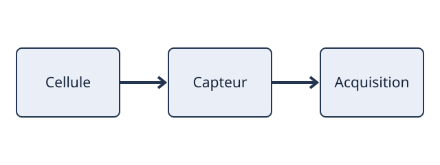

#+TITLE: 11 — Markup for Rich Contents · Exercices
#+LANGUAGE: fr
#+OPTIONS: toc:2 num:nil
#+SUBTITLE: Org Mode Compact Guide, chapitre 11

* 11 — Markup for Rich Contents
Référence : [[https://orgmode.org/orgguide.html][Org Mode Compact Guide]].
Atelier : [[file:../ateliers/11-markup-for-rich-contents.org][ouvrir le fichier à modifier]].
Corrigé : [[file:../corriges/11-markup-for-rich-contents.org][consulter après réalisation]].
Les objectifs et critères sont originaux. Réaliser les opérations dans l’atelier,
pas dans ce fichier d’énoncés. Les commandes ci-dessous suivent le guide officiel.

** 11.1 — Paragraphs
Raccourcis et notions : =ligne vide ; \\ ; #+BEGIN_VERSE/QUOTE/CENTER=

*** E11-01-A — Exercice pratique
- Consigne :: Écrire deux paragraphes séparés, forcer une rupture de ligne et comparer le rendu exporté.
- Validation :: Le saut de paragraphe et la rupture de ligne ne sont pas confondus.
- Suivi :: Cocher E11-01-A dans le fichier PROGRESSION.org.

*** E11-01-B — Exercice pratique
- Consigne :: Composer un bloc VERSE, un bloc QUOTE et un bloc CENTER à partir de notes originales.
- Validation :: Chaque bloc conserve la disposition ou l’alignement attendu après export.
- Suivi :: Cocher E11-01-B dans le fichier PROGRESSION.org.

** 11.2 — Emphasis and Monospace
Raccourcis et notions : =*gras* ; /italique/ ; _souligné_ ; +barré+ ; =verbatim= ; ~code~=

*** E11-02-A — Exercice pratique
- Consigne :: Écrire une phrase montrant les six formes d’emphase de Org.
- Validation :: Le rendu de chaque délimiteur est distinct à l’export.
- Suivi :: Cocher E11-02-A dans le fichier PROGRESSION.org.

*** E11-02-B — Exercice pratique
- Consigne :: Placer une chaîne contenant des caractères Org dans un fragment verbatim et un fragment code.
- Validation :: La syntaxe Org contenue dans =...= ou ~...~ n’est pas réinterprétée.
- Suivi :: Cocher E11-02-B dans le fichier PROGRESSION.org.

** 11.3 — Embedded LaTeX
Raccourcis et notions : =\alpha ; _{...} ; $...$ ; \(...\) ; \[...\] ; equation=

*** E11-03-A — Exercice pratique
- Consigne :: Insérer une équation de bilan énergétique en ligne et en bloc, avec indice et exposant.
- Validation :: Les deux formes de délimiteurs TeX/LaTeX sont valides et les accolades désambiguïsent les indices.
- Suivi :: Cocher E11-03-A dans le fichier PROGRESSION.org.

*** E11-03-B — Exercice pratique
- Consigne :: Créer un environnement equation et une commande de symbole grec, puis lancer un export LaTeX.
- Validation :: Le texte .tex contient une équation et les symboles attendus.
- Suivi :: Cocher E11-03-B dans le fichier PROGRESSION.org.

** 11.4 — Literal examples
Raccourcis et notions : =#+BEGIN_EXAMPLE ; : texte ; #+BEGIN_SRC ; C-c '=

*** E11-04-A — Exercice pratique
- Consigne :: Insérer un extrait de journal en bloc EXAMPLE, puis un exemple commençant par « : ».
- Validation :: Les caractères de balisage sont exportés littéralement.
- Suivi :: Cocher E11-04-A dans le fichier PROGRESSION.org.

*** E11-04-B — Exercice pratique
- Consigne :: Écrire un bloc SRC emacs-lisp et l’ouvrir dans le buffer d’édition spécialisé.
- Validation :: C-c ' ouvre puis referme le buffer en préservant le contenu.
- Suivi :: Cocher E11-04-B dans le fichier PROGRESSION.org.

** 11.5 — Images
Raccourcis et notions : = ; #+CAPTION ; #+NAME=

*** E11-05-A — Exercice pratique
- Consigne :: Ajouter un lien autonome à la figure SVG fournie avec une légende et un nom.
- Validation :: L’export HTML référence la figure et présente sa légende.
- Suivi :: Cocher E11-05-A dans le fichier PROGRESSION.org.

*** E11-05-B — Exercice pratique
- Consigne :: Créer un renvoi interne à la figure via son nom et comparer au lien de fichier.
- Validation :: Le renvoi désigne la figure nommée et le chemin relatif reste valide.
- Suivi :: Cocher E11-05-B dans le fichier PROGRESSION.org.

** 11.6 — Creating Footnotes
Raccourcis et notions : =[fn:nom] ; C-c C-x f ; C-c C-c=

*** E11-06-A — Exercice pratique
- Consigne :: Ajouter une note de bas de page à un constat expérimental et sa définition en colonne zéro.
- Validation :: La référence pointe vers une définition unique et la note apparaît à l’export.
- Suivi :: Cocher E11-06-A dans le fichier PROGRESSION.org.

*** E11-06-B — Exercice pratique
- Consigne :: Naviguer entre référence et définition puis renuméroter/organiser via le menu préfixé.
- Validation :: La note reste liée après réorganisation et son numéro est stable dans l’export.
- Suivi :: Cocher E11-06-B dans le fichier PROGRESSION.org.

* Bilan du chapitre
- Ai-je testé les raccourcis dans Emacs plutôt que seulement lire la syntaxe ?
- Puis-je reproduire les résultats sur un autre fichier sans recopier le corrigé ?
- Quel comportement dépend de ma version ou configuration d’Org ?
